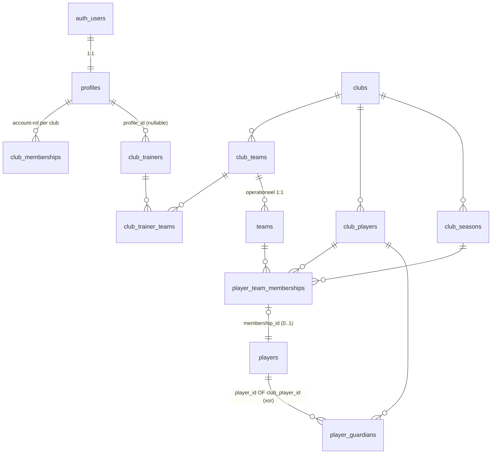
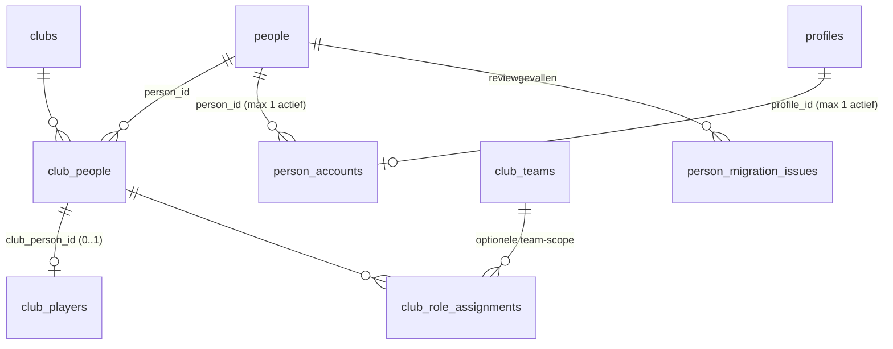

# Personen, accounts en clubfuncties — een laag boven de bestaande spelersidentiteit

## Status

Fase 1 (audit + ontwerp). Geen productiedata gewijzigd. Geen schema aangepast. Dit document is
het resultaat van de audit die de startopdracht vroeg en wacht op expliciete goedkeuring voordat
Fase 2 (additief schema) begint.

## Doel

Vandaag bestaat een natuurlijke persoon in CBCS impliciet, verspreid over losse tabellen die elk
hun eigen identiteitsbegrip hebben: een speler is een `club_players`-rij, een trainer is een
`club_trainers`-rij, een accounthouder is een `profiles`-rij. Er is geen tabel die zegt "dit is
Dylan Bauwens, ongeacht welke rollen hij draagt". Dit plan voegt die laag toe: `people`,
`person_accounts`, `club_people` en een generieke `club_role_assignments`-tabel, zonder de
bestaande, al goedgekeurde spelersarchitectuur (`club_players`, `club_seasons`,
`player_team_memberships`, operationele `players`) opnieuw te ontwerpen of te vervangen.

## 1. Bevestiging: wat is al gebouwd en blijft bron van waarheid

Gelezen: `AGENTS.md`, root- en `website/README.md`, `website/docs/club-player-identity-and-seasons-plan.md`,
`website/docs/club-team-roster-plan.md`, `website/docs/intradesk-visibility-and-permissions-plan.md`,
alle 85 migraties in `website/supabase/migrations/` (met bijzondere aandacht voor 0001, 0007,
0016–0036, 0049, 0055, 0057–0064 en alle latere consumers tot en met 0085), en de
Clubbeheer-UI/routes
(`ClubTeamsManager.tsx`, `ClubDashboard.tsx`, `api/club/teams/route.ts`,
`api/club/teams/[teamId]/roster/route.ts`, `api/club-invitations/*`).

**Twee documentatiebestanden zijn merkbaar verouderd** en beschrijven niet meer de huidige
applicatie: root-`AGENTS.md` beschrijft nog een lokale desktop-app zonder club/parent/account-
functionaliteit, en `website/README.md` somt "Not built yet" op voor dingen die intussen wél
bestaan (club-brede rollen, guardians, meerdere teamrollen). Geen van beide is tegengesproken
door dit plan; ze worden gewoon niet als bron van waarheid gebruikt voor dit ontwerp. Aanbeveling
(niet in scope van deze migratie): bijwerken zodra er ruimte is, zodat een volgende agent niet
opnieuw met een verouderd beeld start.

Bevestigd live en behandeld als bestaande, goedgekeurde fundering — **niet opnieuw ontworpen**:

| Tabel/functie | Rol | Bron |
|---|---|---|
| `club_players` | Clubbrede spelersidentiteit, `match_key` op genormaliseerde naam+geboortedatum, valt terug op eigen `id` zonder DOB (nooit automatisch samenvoegen) | `0030` |
| `club_seasons` | Echte seizoenstabel, 1 actief seizoen per club via `set_active_club_season()` | `0030` |
| `player_team_memberships` | Canonieke, seizoensgebonden many-to-many teamlidmaatschap; `primary`/`secondary`/`guest`; clubgrenzen afgedwongen via trigger | `0030` |
| `players.membership_id` | Enige koppelpunt tussen operationele rij (tags/clips/matches) en membership | `0030` |
| `club_player_migration_issues` | Reviewtabel voor de backfill, nooit stilzwijgend samenvoegen | `0030`/`0031` |
| `backfill_club_players_from_players()` | Idempotente, al uitgevoerde backfill | `0031` |
| `import_roster_rows_merge`, `remove_roster_players`, `search_club_players_for_assignment`, `add_club_player_to_team`, `resolve_primary_membership`, `merge_club_players` | PSD-import (toevoegen/bijwerken/synchroniseren/vervangen), "bestaande speler aan team toevoegen", primary-conflicten oplossen, dubbels samenvoegen | `0032`–`0033` |
| `player_guardians`/`player_invites` met `club_player_id` + `access_scope` | Ouder-toegang, al club-brede-speler-bewust | `0034`/`0036` |

Deze migratie **breidt uit**, **verwijdert niets**, en voegt precies één koppelpunt toe aan
`club_players` (zie §4).

## 2. Kritieke bevindingen uit de audit

Twee bestaande mechanismen doen vandaag al *iets* van wat dit plan wil, maar op een manier die
precies de valkuil bevat die de opdracht wil vermijden — dit is niet theoretisch, het gebeurt nu:

**A. `complete_club_team_onboarding()` (0021, laatst gewijzigd in 0055) claimt een bestaande
`club_trainers`-placeholder puur op naam:**

```sql
update public.club_trainers
set profile_id = target_user_id, invitation_status = 'linked'
where club_id = selected_club_id
  and profile_id is null
  and lower(trim(display_name)) = lower(trim(trainer_name_value))
```

Concrete bron: `website/supabase/migrations/0055_link_signup_to_existing_trainer_placeholder.sql:
84-94`; de naamvergelijking zelf staat op regel 91. De functie wordt nog aangeroepen vanuit de
actuele registratietrigger in `0061_platform_registration_invitations.sql:115-117`.

Wie zich registreert met een naam die toevallig (exact, na trim/lowercase) overeenkomt met een
bestaande placeholder-trainer, "wordt" die trainer — zonder geboortedatum, e-mail, telefoon of
clubadmin-bevestiging. Dit is precies het "naam alleen is nooit voldoende"-scenario dat de
opdracht expliciet verbiedt voor de nieuwe laag. Het treft vandaag alleen de eigen-club-onboarding-
flow (`club_onboarding`, iemand die zelf een nieuwe club/team aanmaakt of aansluit via de publieke
registratie); `club_registration_invites` (0059/0061, de uitnodigingsflow) is al veiliger: die
vereist een single-use token en controleert optioneel `expected_name`/`contact_email` tegen wat
werd ingevuld. **Aanbeveling**: het nieuwe accountclaim-mechanisme (§6) vervangt geleidelijk het
naam-only-pad in `complete_club_team_onboarding` in migratie 0088. Geen enkele nieuwe of bestaande
`people`/`club_people`-koppeling mag daarna die naam-only-heuristiek gebruiken.

**B. "Coaches toewijzen" op de teamkaart (`ClubTeamsManager.tsx` + `PUT /api/club/teams`) kan
uitsluitend een bestaande `club_trainers`-rij mét `profile_id` gezet toewijzen:**

```ts
const { data: trainer } = await ctx.admin.from("club_trainers").select("id")
  .eq("club_id", team.club_id).eq("profile_id", profileId).maybeSingle();
if (!trainer) return NextResponse.json({ error: "Gebruiker is geen lid van deze club." }, { status: 400 });
```

Concrete bron: de UI schakelt placeholders zonder `profile_id` uit en verstuurt uitsluitend een
`profileId` in `website/src/app/dashboard/club/ClubTeamsManager.tsx:342-352`; de API zoekt daarna
uitsluitend op `(club_id, profile_id)` in `website/src/app/api/club/teams/route.ts:90-105`.
De bestaande spelerszoeker gebruikt daarentegen wel de clubbrede spelersbron
(`ClubTeamsManager.tsx:193-207`, toevoegen op `:270-280`).

Er bestaat vandaag geen weg om Dylan (die alleen als `club_players`-rij bestaat) als trainer te
vinden en toe te wijzen — hij is geen `club_trainers`-rij en heeft geen `profileId`. Dit is exact
de ontbrekende "Persoon met functie toevoegen"-flow uit de opdracht (§7), niet een bug: het
bestaande systeem is nooit ontworpen om een speler een niet-spelersfunctie te geven.

## 3. ERD — huidig model (vereenvoudigd, relevante delen)



Kernprobleem zichtbaar in dit diagram: er loopt **geen enkele lijn** tussen `club_players` en
`club_trainers`/`club_memberships`/`profiles`. Drie volledig gescheiden identiteitsbegrippen voor
dezelfde mogelijke natuurlijke persoon.

## 4. ERD — voorgesteld model (additief)



`club_people` is het scharnierpunt: één rij per (club, persoon). Alles wat vandaag al bestaat
(`club_players`, `club_trainers`, `club_memberships`) hangt via `club_people` aan dezelfde
persoon, zonder dat die tabellen zelf hoeven te veranderen in Fase 2.

### Nieuwe tabellen (Fase 2, na goedkeuring van dit document)

**`people`** — blijvende identiteit van een natuurlijke persoon, clubonafhankelijk.

```sql
create table public.people (
  id uuid primary key default gen_random_uuid(),
  first_name text not null,
  last_name text not null,
  date_of_birth date,                    -- nullable: zie club_players-precedent, zelfde reden
  status text not null default 'active' check (status in ('active', 'merged', 'archived')),
  merged_into_person_id uuid references public.people(id) on delete set null,
  created_at timestamptz not null default now(),
  updated_at timestamptz not null default now()
);
```

Bewust **geen** `email`/`phone`/`club_id`-kolommen: contactgegevens horen bij de clubrelatie
(`club_people`, spiegelt hoe `club_players` dat vandaag al doet) of bij het account
(`profiles.email`), niet bij de persoon zelf — anders zou een clubwissel of e-mailwijziging een
schrijfactie op een tabel vereisen die ook door andere clubs "gezien" wordt.

**`person_accounts`**

```sql
create table public.person_accounts (
  id uuid primary key default gen_random_uuid(),
  person_id uuid not null references public.people(id) on delete restrict,
  profile_id uuid not null references public.profiles(id) on delete restrict,
  status text not null default 'active'
    check (status in ('pending', 'active', 'revoked', 'rejected')),
  link_method text not null
    check (link_method in ('personal_invite', 'admin_review', 'verified_import')),
  verified_at timestamptz,
  verified_by uuid references public.profiles(id) on delete set null,
  revoked_by uuid references public.profiles(id) on delete set null,
  revoke_reason text,
  revoked_at timestamptz,
  created_at timestamptz not null default now(),
  updated_at timestamptz not null default now(),
  unique (person_id, profile_id)
);
create unique index person_accounts_one_active_person_idx
  on public.person_accounts(person_id) where status = 'active' and revoked_at is null;
create unique index person_accounts_one_active_profile_idx
  on public.person_accounts(profile_id) where status = 'active' and revoked_at is null;
```

De twee partiële unieke indexen zijn de daadwerkelijke afdwinging van "geen tweede actief account
voor dezelfde persoon" én "een account vertegenwoordigt maar één persoon tegelijk" — beide op
databaseniveau, niet alleen in applicatiecode.

**`club_people`**

```sql
create table public.club_people (
  id uuid primary key default gen_random_uuid(),
  club_id uuid not null references public.clubs(id) on delete restrict,
  person_id uuid not null references public.people(id) on delete restrict,
  external_member_id text,
  status text not null default 'active' check (status in ('active', 'inactive')),
  joined_at date not null default current_date,
  left_at date,
  created_at timestamptz not null default now(),
  updated_at timestamptz not null default now(),
  unique (club_id, person_id)
);
```

**`club_players.club_person_id`** — het enige nieuwe koppelpunt op een bestaande tabel:

```sql
alter table public.club_players
  add column club_person_id uuid references public.club_people(id) on delete set null;
create unique index club_players_club_person_unique_idx
  on public.club_players(club_person_id) where club_person_id is not null;
```

*Ontwerpbeslissing (was open in de opdracht: `club_person_id` vs. rechtstreeks `person_id`)*:
gekozen voor `club_person_id` naar `club_people`, niet rechtstreeks naar `people`. Reden: een
`club_players`-rij hoort altijd bij precies één club (`club_players.club_id` bestaat al); door via
`club_people` te koppelen in plaats van rechtstreeks naar `people`, hangt de club-relatie
(`status`/`joined_at`/`left_at`/`external_member_id`) op één plek en kan een `club_players`-rij
nooit per ongeluk naar een `club_people`-rij van een andere club wijzen zonder dat een trigger dat
moet controleren (een rechtstreekse `person_id`-FK zou die controle apart nodig hebben, net zoals
`enforce_membership_club_match()` dat vandaag al doet voor `player_team_memberships`). Dit spiegelt
exact hoe `players.membership_id` in 0030 werd gekozen boven een rechtstreekse
`players.club_player_id`: één koppelpunt, geen tweede mogelijk-tegenstrijdige waarheid.

**`club_role_assignments`** — generieke, tijdgebonden clubfunctie:

```sql
create table public.club_role_assignments (
  id uuid primary key default gen_random_uuid(),
  club_person_id uuid not null references public.club_people(id) on delete restrict,
  role_type text not null check (role_type in (
    'trainer', 'assistant_trainer', 'goalkeeper_coach', 'team_manager', 'scout',
    'hospitality_worker', 'volunteer', 'board_member', 'club_employee', 'other'
  )),
  custom_role_name text,                 -- vrije titel wanneer role_type = 'other', spiegelt club_memberships.custom_role_name
  club_team_id uuid references public.club_teams(id) on delete restrict,
  clubwide boolean not null default false,
  valid_from date not null default current_date,
  valid_until date,
  status text not null default 'active' check (status in ('active', 'suspended', 'ended')),
  created_by uuid references public.profiles(id) on delete set null,
  created_at timestamptz not null default now(),
  revoked_at timestamptz,
  revoked_by uuid references public.profiles(id) on delete set null,
  updated_at timestamptz not null default now(),
  check (club_team_id is not null or clubwide),
  check (valid_until is null or valid_from <= valid_until)
);
```

*Ontwerpbeslissing (was open: één generieke tabel vs. domeinspecifieke detailtabellen)*: één
generieke tabel voor Fase 2. Reden: alle voorbeeldfuncties (trainer, scout, horeca,
videomedewerker, ...) hebben identieke levenscyclusvelden (wie, welke club, welk team of
clubbreed, vanaf-tot, status). Concrete *rechten* per rol (zie §8) worden niet in deze tabel
gecodeerd maar afgeleid via een capability-lookup (analoog aan het bestaande
`club_role_permission_defaults`-patroon uit 0063) — dat scheidt "welke functie heeft iemand" van
"wat mag die functie", en laat een club later een functie hernoemen/herconfigureren zonder de
rij zelf te moeten migreren. Mocht een rol echt domeinspecifieke kolommen nodig hebben (bv. een
scout die een schaal/notitieveld per bekeken speler bijhoudt), dan komt die als een aparte tabel
die naar `club_role_assignments.id` verwijst — niet als kolom op deze tabel zelf.

Bewust **niet vervangen**: `club_memberships`/`club_trainers`/`club_trainer_teams`/
`club_member_permissions`/`club_role_permission_defaults` blijven als compatibility-consumers
bestaan zolang bestaande code erop leest. Ze mogen echter niet onafhankelijk dezelfde functie
beheren. Daarom krijgt `club_trainers` een nullable, unieke `club_person_id` (`on delete restrict`)
en krijgt `club_trainer_teams` een nullable, unieke `club_role_assignment_id` (`on delete
restrict`). Voor trainerrollen is `club_role_assignments` de canonieke bron en is de oude
trainer/teamcombinatie een transactioneel onderhouden projectie. Alle nieuwe writes lopen via
`assign_club_role()`/`end_club_role()`; dezelfde transactie upsert of beëindigt de compatibilityrij.
Rechtstreekse nieuwe writes naar gekoppelde legacyrijen worden door een trigger geweigerd, behalve
vanuit de interne projectiefunctie. Oude, nog niet gemapte rijen blijven leesbaar en komen in de
reviewlijst; er gebeurt nooit synchronisatie op naam. Rollen zonder legacy-equivalent (scout,
horecamedewerker, vrijwilliger enz.) bestaan uitsluitend in `club_role_assignments`.

**`person_migration_issues`** — reviewtabel voor de backfill, analoog aan
`club_player_migration_issues` maar met heterogene bronnen (een `club_players`-rij, een
`club_trainers`-rij en een `club_memberships`-rij kunnen elk apart aanleiding geven tot een
persoonsreviewgeval):

```sql
create table public.person_migration_issues (
  id uuid primary key default gen_random_uuid(),
  club_id uuid not null references public.clubs(id) on delete restrict,
  source_type text not null check (source_type in ('club_player', 'club_trainer', 'club_membership')),
  source_id uuid not null,
  candidate_person_id uuid references public.people(id) on delete set null,
  issue_type text not null check (issue_type in (
    'possible_cross_identity_match', 'missing_date_of_birth', 'conflicting_contact_data', 'ambiguous_name_match'
  )),
  issue_key text not null unique,
  details jsonb not null default '{}',
  status text not null default 'open' check (status in ('open', 'resolved', 'ignored')),
  created_at timestamptz not null default now(),
  resolved_at timestamptz,
  resolved_by uuid references public.profiles(id) on delete set null
);
```

`possible_cross_identity_match` is het nieuwe, belangrijke issue-type: "deze `club_trainers`-rij
en deze `club_players`-rij hebben dezelfde genormaliseerde naam (en evt. geboortedatum), zijn dit
dezelfde persoon?" — precies het Dylan-scenario zodra hij ooit wél als trainer geregistreerd zou
worden vóór een clubadmin dat expliciet bevestigt.

**`identity_audit_log`** — generiek, zie §10.

## 5. Foreign-key- en RLS-impact van de nieuwe tabellen

Geen enkele bestaande FK wordt gewijzigd. Alleen toegevoegd: `club_players.club_person_id`
(nullable, `on delete set null`, dus een verwijderde `club_people`-rij kan nooit een bestaande
`club_players`-rij laten crashen). Alle nieuwe tabellen krijgen RLS naar hetzelfde patroon als
`club_players`/`player_team_memberships` in 0030:

- **`people`**: geen rechtstreekse RLS-policy voor gewone gebruikers nodig — deze tabel wordt
  nooit rechtstreeks bevraagd door de UI, enkel via `club_people`/RPC's (zelfde patroon als
  `upsert_club_player_contact_merge` die vandaag ook niet rechtstreeks voor `authenticated`
  opengesteld is). `revoke all ... from public, anon, authenticated`, toegang enkel via
  `security definer`-functies.
- **`person_accounts`**: select voor de eigen rij (`profile_id = auth.uid()`); verder enkel via
  RPC's (accountclaim, §6).
- **`club_people`**: select voor club-admins van die club (`is_active_club_admin`, herbruikt uit
  0030) en voor elke actief-toegewezen trainer die de gekoppelde `club_players`/
  `club_role_assignments`-rij al mag zien (spiegelt `can_view_team_membership`); insert/update/
  delete club-admin-only.
- **`club_role_assignments`**: select voor club-admins clubbreed; voor een niet-club-admin enkel
  de eigen toegewezen rijen (`club_person_id in (select cp.id from club_people cp join
  person_accounts pa on pa.person_id = cp.person_id where pa.profile_id = auth.uid() and
  pa.revoked_at is null)`) plus rijen van teams waar diegene al toegang toe heeft (voor "wie is
  hier trainer/scout" op een teamkaart). Insert/update/delete club-admin-only, via een
  `security definer`-RPC (zie §7) die zelf nogmaals controleert — zelfde dubbele-slot-patroon als
  `create_club_player_with_membership`.
- **`person_migration_issues`**: club-admin-only, identiek aan `club_player_migration_issues`.

Geen van deze policies introduceert cross-club-lekkage: elke policy filtert via `club_id` op
`club_people`/`club_role_assignments` zelf, nooit via een clubonafhankelijke `people`-tabel-scan.

## 6. Accountclaim — hergebruik van een bestaand, veiliger patroon

`club_registration_invites` (0059/0061) is al bijna wat de opdracht vraagt: single-use token,
optionele `expected_name`/`contact_email`-controle, `handle_new_user()` verwerkt de acceptatie.
Voorstel: **uitbreiden**, niet vervangen. De huidige `uuid token` staat wel bruikbaar in de
database; voor persoonsclaims wordt daarom een nieuw willekeurig geheim alleen aan de ontvanger
getoond en uitsluitend `token_hash = digest(token, 'sha256')` opgeslagen. De uitnodiging krijgt
`club_person_id`, `status`, `expires_at`, `used_at`, `used_by`, `created_by` en auditvelden.
Verificatie vergelijkt de hash constant-time in een server-side RPC en lockt de uitnodigingsrij
`for update`. Naam/e-mail blijven hoogstens extra signalen; alleen de concrete uitnodiging bewijst
de bedoelde persoon.

```sql
alter table public.club_registration_invites
  add column club_person_id uuid references public.club_people(id) on delete restrict;
```

Wanneer een clubadmin vanuit een gevonden `club_people`-rij (via de nieuwe zoekfunctie, §7) een
uitnodiging genereert, wordt `club_person_id` meteen ingevuld — de identiteit staat dus al vóór
verzending vast, in tegenstelling tot vandaag waar `expected_name` pas ná ontvangst wordt
vergeleken met wat werd ingetypt. `handle_new_user()` krijgt een extra tak: als
`club_invite.club_person_id` gezet is, wordt na de bestaande validaties een `person_accounts`-rij
aangemaakt in plaats van (of naast) de bestaande `club_memberships`/`club_trainers`-inserts:

```sql
if club_invite.club_person_id is not null then
  select person_id into v_person_id from public.club_people where id = club_invite.club_person_id;
  insert into public.person_accounts (person_id, profile_id, verified_at, verified_by)
  values (v_person_id, new.id, timezone('utc'::text, now()), club_invite.created_by);
end if;
```

Dit dekt zowel "nieuwe uitnodiging voor iemand zonder account" als "Dylan heeft al een
trainersaccount, koppel er zijn spelersidentiteit aan" — in beide gevallen ontstaat er precies één
`person_accounts`-rij, nooit een tweede `auth.users`-rij. Een gewone publieke registratie zonder
`club_invite_token`/`club_person_id` blijft ongewijzigd: die claimt nooit automatisch een
bestaande persoon (spiegelt hoe `complete_club_team_onboarding`'s naam-only-pad hier bewust
*niet* wordt hergebruikt, zie §2A).

## 7. De twee zoek- en toewijzingsflows in Clubbeheer

**"Bestaande speler aan team toevoegen"** bestaat al volledig
(`search_club_players_for_assignment` + `add_club_player_to_team`, zichtbaar in
`ClubTeamsManager.tsx` als "Voeg speler toe aan dit team"). Geen wijziging nodig in Fase 5, buiten
een latere, niet-blokkerende aanvulling: wanneer `create_club_player_with_membership` een
gloednieuwe `club_players`-rij aanmaakt, in dezelfde canonieke command-RPC ook meteen een
`club_people`+`people`-rij aanmaken zodat nieuwe spelers nooit als reviewgeval eindigen.

**"Persoon met functie toevoegen"** is nieuw. Voorgestelde RPC's, naar het patroon van
`search_club_players_for_assignment`/`add_club_player_to_team`:

```sql
create or replace function public.search_club_people_for_role_assignment(
  target_club_id uuid, search_term text default ''
) returns table (
  club_person_id uuid, first_name text, last_name text, birth_year int,
  current_player_teams text[], current_roles text[], has_account boolean
) language plpgsql stable security definer set search_path = public as $$ ... $$;
```

Doorzoekt `club_people` (join `people`) van de opgegeven club — dus zowel personen die al
`club_players` zijn (Dylan) als personen die al een `club_role_assignments`/`club_trainers`-rij
hebben, in één resultaat. Zelfde velduitsluiting als vandaag: geen e-mail/telefoon/adres in de
return-kolommen. `has_account` leest `exists (select 1 from person_accounts where person_id = ...
and revoked_at is null)` — de UI toont dit als "Geregistreerd"/"Nog niet geregistreerd" precies
zoals de opdracht vraagt.

```sql
create or replace function public.assign_club_role(
  target_club_person_id uuid, p_role_type text, p_club_team_id uuid default null,
  p_clubwide boolean default false, p_valid_from date default current_date,
  p_valid_until date default null, p_custom_role_name text default null
) returns uuid language plpgsql security definer set search_path = public as $$ ... $$;
```

Club-admin-only (via `is_active_club_admin`, herbruikt uit 0030), auth.uid()-gated, schrijft een
`club_role_assignments`-rij en een `identity_audit_log`-rij. Maakt **nooit** een nieuwe
`people`/`club_people`-rij aan — die moet al bestaan (gevonden via de zoekfunctie hierboven, of
expliciet nieuw aangemaakt via een aparte "Nieuwe persoon toevoegen"-actie die zelf een
dubbelcheck afdwingt, zie §11 duplicatecontrole).

UI-plaatsing: een tweede, identiek vormgegeven blok naast het bestaande "Voeg bestaande speler
toe"-blok in `TeamEditor` (`ClubTeamsManager.tsx`), met dezelfde debounce-zoekpatroon
(300 ms, min. 2 tekens) als de bestaande spelerszoekfunctie.

### Dylan-flow, expliciet

1. Clubadmin bij Gew. U17 opent "Persoon met functie toevoegen", typt "Dylan Bauwens".
2. `search_club_people_for_role_assignment` vindt de `club_people`-rij die in Fase 4 werd
   aangemaakt vanuit zijn bestaande `club_players`-rij bij KMT B — toont "Speler KMT B" onder
   "Huidige rollen" en "Nog niet geregistreerd" onder account.
3. Clubadmin kiest rol Trainer, team Gew. U17, `valid_from` = vandaag.
4. `assign_club_role` schrijft één `club_role_assignments`-rij, gekoppeld aan dezelfde
   `club_person_id` als zijn spelersrij. Geen nieuwe `people`-rij, geen nieuwe `club_players`-rij.
5. Optioneel: clubadmin klikt "Uitnodigen voor CBCS" → nieuwe `club_registration_invites`-rij met
   `club_person_id` ingevuld (§6).
6. Bij registratie ontstaat één `person_accounts`-rij; Dylans account toont vanaf dan zowel zijn
   spelerscontext (via `club_players.club_person_id`) als zijn trainerscontext (via
   `club_role_assignments.club_person_id`) — beide wijzen naar dezelfde `club_people.id`.

## 8. Autorisatie — rechten blijven afgeleid, niet hardcoded op de rol

Zelfde beslissing als het bestaande `club_role_permission_defaults`-patroon (0063): `role_type`
op `club_role_assignments` bepaalt een *default* capability-set, een club-admin kan individuele
capabilities per toewijzing overschrijven via een nieuwe `club_role_assignment_permissions`-tabel
(analoog aan `club_member_permissions`). Voorbeeldmapping bij creatie:

| `role_type` | default capabilities |
|---|---|
| `horeca` | geen `players.*`, geen `video.*`, geen `training.notes.*` |
| `scout` | `scouting.view` binnen eigen `club_team_id`/`clubwide`-scope, geen andere clubdata |
| `club_employee` met passende capability | alleen expliciet toegekende module-capabilities |
| `trainer`/`assistant_trainer` | zelfde default-set als vandaag `club_role_permission_defaults` voor `trainer` toekent |

Een verlopen (`valid_until < current_date`) of ingetrokken (`status <> 'active'`) toewijzing mag
in geen enkele policy meetellen — elke nieuwe RLS-check op basis van `club_role_assignments` moet
expliciet `status = 'active' and (valid_until is null or valid_until >= current_date)` opnemen,
niet enkel op het bestaan van de rij filteren.

## 9. Migratiefasen (herbevestigd t.o.v. de opdracht, met de bovenstaande concrete keuzes)

1. **Audit en ontwerp** — dit document. Geen productiedata gewijzigd.
2. **0086 `people_accounts_and_club_roles_schema.sql`** — enums/checks, `people`,
   `person_accounts`, `club_people`, `club_role_assignments`, `person_claim_reviews`,
   `person_migration_issues`, `identity_audit_log`, nullable `club_players.club_person_id`,
   nullable compatibility-FK's, alle constraints/indexen en RLS. Geen backfill.
3. **0087 `person_identity_commands.sql`** — server-only, concurrency-safe RPC's voor create,
   merge, claim, revoke, rol starten/beëindigen en de transactionele `club_trainers`-projectie.
4. **0088 `person_invitation_claims.sql`** — gehashte persoonlijke uitnodigingen,
   pending-reviewflow en vervanging van iedere naam-only claim in
   `complete_club_team_onboarding()` en `handle_new_user()`. Geen backfill.
5. **Clubgescopeerd zoeken en rolbeheer (applicatielaag)** — gerealiseerd via de beveiligde
   serverroutes `/api/club/people` en `/api/club/person-roles`. Daardoor was geen afzonderlijke
   migratie `0089` nodig. Een eventuele latere database-RPC krijgt migratienummer `0091` of hoger,
   omdat `0090` inmiddels in productie geregistreerd staat.
6. **0090 `club_people_backfill.sql`** — definieert alleen de reproduceerbare dry-run en
   idempotente uitvoerfunctie; roept de uitvoerfunctie niet aan. Eerst read-only dry-run en stop
   voor goedkeuring.
7. **Back-up en backfill** — pas na afzonderlijke goedkeuring: 1 `people`-rij per bestaande
   `club_players`-rij (of
   hergebruik bij een bevestigd cross-identity-match uit de dry-run), idem voor `club_trainers`/
   `club_memberships`-rijen zonder al-gekoppelde persoon; `club_players.club_person_id` invullen;
   `person_accounts` voor elk gekoppeld `profiles`-record; twijfelgevallen naar
   `person_migration_issues`. Geen `auth.users`-rij ooit aangemaakt door deze stap.
8. **Applicatiecode** — de twee zoekflows (§7), accountclaim-uitbreiding (§6), "Mijn loopbaan"/
   "Mijn clubfuncties"/"Club wisselen"-UI-contexten.
9. **Compatibiliteit** — `create_club_player_with_membership` en de trainer-onboarding-paden
   roepen dezelfde canonieke commands aan. Alleen die commands schrijven de nieuwe bron en de
   gekoppelde legacyprojectie transactioneel; er zijn geen twee onafhankelijke writers.
10. **Opschoning** — pas wanneer alle reads/writes aantoonbaar op het nieuwe model draaien:
   bevestigde `people`-dubbels samenvoegen, evaluatie of `club_trainers`/`club_memberships` ooit
   volledig kunnen vervallen (waarschijnlijk niet binnen de scope van dit plan — ze dragen ook
   niet-identiteitsgebonden data zoals `team_scope`/`club_member_permissions`).

## 10. Auditlog

```sql
create table public.identity_audit_log (
  id uuid primary key default gen_random_uuid(),
  actor_profile_id uuid references public.profiles(id) on delete set null,
  action text not null,
  target_table text not null,
  target_id uuid not null,
  old_status text,
  new_status text,
  reason_code text,
  details jsonb not null default '{}',
  created_at timestamptz not null default now()
);
```

Minimaal gelogde acties: `person_created`, `person_merged`, `account_linked`,
`account_link_revoked`, `club_person_created`, `club_person_ended`, `role_assigned`,
`role_revoked`, `role_expired` (door een geplande job, niet interactief), `import_match_confirmed`,
`identity_manual_correction`. RLS: enkel leesbaar voor platform-admins en de club-admin van de
betrokken club (via join naar `club_id` op de target-rij waar van toepassing).

## 11. Dry-runplan voor de huidige ~30 spelers en Dylan

Read-only queries tegen productie (of een kopie), vóór enige schema- of datawijziging van Fase 4:

```sql
-- Basistellingen
select count(*) from public.profiles;
select count(*) from public.club_players;
select count(*) from public.players;
select count(*) from public.player_team_memberships;
select count(*) from public.club_trainers;
select count(*) from public.club_memberships;

-- Elke club_players-rij: voorgestelde people-koppeling + al-bestaande review-signalen
select cp.id, cp.first_name, cp.last_name, cp.date_of_birth, cp.email,
       (cp.date_of_birth is null) as missing_dob
from public.club_players cp;

-- Mogelijke overlap tussen een club_players-rij en een club_trainers-rij (potentiële
-- Dylan-achtige gevallen): NOOIT automatisch samenvoegen, enkel rapporteren.
select cp.id as club_player_id, cp.first_name, cp.last_name, cp.date_of_birth,
       ct.id as club_trainer_id, ct.display_name
from public.club_players cp
join public.club_trainers ct
  on public.normalize_person_name(cp.first_name || cp.last_name)
   = public.normalize_person_name(ct.display_name)
where ct.club_id = cp.club_id;

-- Dylan Bauwens expliciet
select cp.*, exists (
  select 1 from public.club_trainers ct
  where ct.club_id = cp.club_id
    and public.normalize_person_name(ct.display_name) = public.normalize_person_name(cp.first_name || cp.last_name)
) as has_matching_trainer_row
from public.club_players cp
where public.normalize_person_name(cp.last_name) = public.normalize_person_name('Bauwens')
  and public.normalize_person_name(cp.first_name) = public.normalize_person_name('Dylan');

-- Bestaande accounts die al aan een club_players-rij zouden kunnen horen (via e-mail-match,
-- enkel signaal, nooit grond voor automatische koppeling)
select cp.id as club_player_id, cp.email, p.id as profile_id, p.email as profile_email
from public.club_players cp
join public.profiles p on lower(trim(p.email)) = lower(trim(cp.email))
where cp.email is not null and cp.email <> '';

-- club_player_migration_issues die nog open staan (moeten vóór Fase 4 opgevolgd zijn, anders
-- erft de nieuwe laag dezelfde onopgeloste twijfelgevallen)
select * from public.club_player_migration_issues where status = 'open';
```

Verwacht resultaat voor Dylan op dit moment: één `club_players`-rij bij KMT B, `date_of_birth`
gezet of niet (te bevestigen tijdens de effectieve dry-run — dit document raadt de query aan,
voert ze niet uit), **geen** overeenkomstige `club_trainers`-rij (zijn trainersfunctie is nog niet
in CBCS geregistreerd), dus `has_matching_trainer_row = false` en geen reviewgeval nodig voor hem
specifiek in Fase 4 — zijn latere trainerstoewijzing gebeurt via de nieuwe UI in Fase 5, niet via
de backfill.

Het volledige rapport (Fase 3) voegt hieraan toe: spelers per team/seizoen, conflicterende
e-mails/telefoons binnen `club_players`, spelers zonder geboortedatum, en elk geval dat niet
ondubbelzinnig één `people`-rij oplevert — geregistreerd in `person_migration_issues`, nooit
stilzwijgend opgelost.

## 12. Risicoanalyse

| Risico | Impact | Mitigatie |
|---|---|---|
| `people`/`club_people` worden een tweede, langzaam divergerende waarheid naast `club_players`/`club_trainers` | Middel — verwarrende UI, dubbele onderhoudslast | Eén canonieke commandlaag; legacytabellen zijn alleen een gemapte, transactionele projectie |
| Cross-identity-matching (club_player ↔ club_trainer op naam) levert false positives op die een clubadmin te snel bevestigt | Hoog voor privacy/correctheid | Nooit auto-merge; UI toont expliciet beide bronrijen naast elkaar, vereist actieve bevestiging + logt `identity_manual_correction` |
| Verwijderen van de naam-only-claim veroorzaakt onboardingregressie | Middel | 0088 voegt eerst veilige nieuwe-persoon/pending-reviewpaden en regressietests toe en vervangt daarna de claim atomair |
| `club_role_assignments` zonder zorgvuldige RLS opent clubbrede persoonsgegevens voor horeca/scout | Hoog | §8/§5: policies filteren altijd op `club_id` en toewijzingsstatus; capaciteiten expliciet whitelisted, nooit "alles behalve" |
| Backfill loopt tijdens actief gebruik (KM Torhout heeft nu al spelers/clips) | Middel | Fase 4 volledig additief en idempotent, zelfde patroon als `backfill_club_players_from_players()`; draait via service-role, niet vanuit de app |
| `person_accounts`-partiële unieke indexen laten een edge case toe (twee `revoked_at is null`-rijen voor dezelfde persoon als een race optreedt vóór de index bestaat) | Laag | Index wordt in dezelfde migratie als de tabel aangemaakt, vóór enige insert mogelijk is |

## 13. Rollback- en herstelplan

- Fase 2 (schema) is volledig reversibel: alle nieuwe tabellen droppen, `club_players.club_person_id`
  droppen — geen bestaande tabel verliest data omdat er niets aan bestaande tabellen behalve die
  ene kolom wijzigt.
- Fase 4 (backfill) draait via een `security definer`-functie naar het patroon van
  `backfill_club_players_from_players()`: idempotent, dus een mislukte gedeeltelijke run kan
  gewoon herhaald worden. Vóór uitvoering: expliciete databaseback-up (Supabase point-in-time
  recovery of een handmatige `pg_dump` van minstens `club_players`, `club_trainers`,
  `club_memberships`, `profiles`).
- Rollback van een individuele backfill-rij: `club_people`/`person_accounts`/
  `club_role_assignments` verwijderen raakt nooit `club_players`/`club_trainers`/`profiles` zelf
  (enkel `club_players.club_person_id` valt terug op `null` via `on delete set null`).
- Geen enkele stap in dit plan verwijdert een bestaande `auth.users`-rij, `profiles`-rij,
  `club_players`-rij of `player_team_memberships`-rij.

## 14. Definitieve ontwerpkeuzes ter goedkeuring

1. **Eén generieke `club_role_assignments` vs. domeinspecifieke detailtabellen voor scout/horeca.**
   Dit plan kiest generiek + losse capability-tabel (§4/§8). Alternatief: elke functie krijgt een
   eigen tabel zodra ze eigen kolommen nodig heeft. Voorstel: starten generiek, pas opsplitsen bij
   bewezen behoefte.
2. **`club_players.club_person_id` vs. rechtstreeks `person_id`.** Dit plan kiest via
   `club_people` (§4), gemotiveerd. Als je toch een rechtstreekse `person_id`-kolom verkiest
   (bv. omdat je `club_people` liever puur als "lidmaatschapsvenster" zonder extra join-laag
   ziet), is dat een kleine aanpassing vóór Fase 2 start.
3. **De naam-only-claim in `complete_club_team_onboarding` wordt in 0088 verwijderd.** Een gewone
   registratie maakt een nieuwe identiteit of een pending review, maar neemt nooit een bestaande
   persoon of placeholder over. Alleen een geldige, persoonsgebonden uitnodiging kan rechtstreeks
   koppelen.
4. **Retentie/anonymisering van `people`-records na definitief clubvertrek zonder account.** Nog
   niet uitgewerkt in dit document — expliciet genoemd in de opdracht onder "Privacy en
   langetermijn", maar valt buiten wat nodig is om Dylan/de huidige ~30 spelers correct te
   migreren. Voorstel: apart, kort vervolgdocument vóór Fase 7 (opschoning).
5. **Wie mag `search_club_people_for_role_assignment` aanroepen?** Alleen een actieve clubadmin
   (en platformadmin via de bestaande server-authorisatie). De bestaande spelerszoeker blijft zijn
   huidige, ruimere rosterrecht behouden; personen zoeken voor functies is gevoeliger.

## 15. Wat expliciet niet in Fase 1 zit

Zoals gevraagd: geen verantwoordelijke/volger-sponsorsysteem (dat blijft `player_guardians`/
`player_invites` zoals ze vandaag zijn), geen wijziging aan `club_players`/`club_seasons`/
`player_team_memberships`/de PSD-import zelf, geen productiedata aangeraakt, geen schema
aangemaakt. Dit document is het volledige Fase 1-opleverstuk; wacht op expliciete goedkeuring
voordat Fase 2 (additief schema) start.

## 16. Betrokken backend- en frontendbestanden

Database en types:

- nieuw: migraties `0086` t/m `0090` zoals in §9;
- uitbreiden: `website/supabase/tests/club_team_onboarding.test.sql` en nieuwe
  `people_accounts_roles.test.sql`, `person_claims.test.sql`, `club_people_rls.test.sql` en
  `club_people_backfill.test.sql`;
- bijwerken: `website/src/types/database.ts` met nieuwe rijen, statussen en
  `ClubPlayer.club_person_id`.

Backend:

- `website/src/app/api/club/overview/route.ts`: personen, functies en accountstatus voor alleen de
  actieve club, zonder onnodige persoonsgegevens;
- `website/src/app/api/club/teams/route.ts`: trainerstoewijzing via `clubPersonId` en de canonieke
  rol-RPC in plaats van een verplichte `profileId`;
- nieuw: `api/club/people/search/route.ts`, `api/club/roles/route.ts`,
  `api/club/person-invitations/route.ts` en `api/club/person-claims/route.ts`;
- `website/src/app/dashboard/admin/actions.ts:230-255`: ook de tweede naamgebaseerde
  placeholderclaim (`ilike("display_name", fullName)` op regel 244) verwijderen;
- registratie/onboarding: tokens nooit loggen; alleen server-side hashverificatie.

Frontend:

- `website/src/app/dashboard/club/ClubTeamsManager.tsx`: bestaande spelersflow behouden en een
  afzonderlijk personenzoek-/rolformulier toevoegen;
- `ClubDashboard.tsx`: people/roles/accountstatus-DTO's;
- `ClubMemberAccessManager.tsx`: accountrechten gescheiden houden van persoonsfuncties;
- `website/src/i18n/messages.ts`: labels voor alle rollen en zes accountstatussen.

Legacy-consumers die regressietests vereisen maar aanvankelijk niet worden herschreven:
`src/lib/auth/club-access.ts`, `api/club/assignments/route.ts`,
`api/club/teams/[teamId]/trainings/route.ts`, `api/teams/route.ts`,
`api/trainings/save/route.ts`, `api/trainings/sessions/[sessionId]/attendance/route.ts`,
`api/matches/route.ts`, `api/matches/hub/route.ts` en de training/dashboardpagina's die
`club_trainers.id` als operationele trainer-ID gebruiken.

## 17. Testplan en acceptatiecriteria

Database/migratie:

- beide partiële unieke indexen weigeren een tweede actieve koppeling, maar laten ingetrokken
  historie toe;
- twee gelijktijdige claims op hetzelfde token/person/account leveren exact één winnaar;
- uniek `(club_id, person_id)`, persoon zonder account en rol zonder account;
- rol beëindigen bewaart persoon, clubrelatie, spelerhistoriek en auditlog;
- FK-verwijderregels zijn `restrict`/`set null`, nooit cascade naar speler- of rollenhistoriek;
- naam of e-mail alleen maakt hoogstens een reviewrij, nooit een accountkoppeling;
- cross-club lezen/zoeken/toewijzen/claimen wordt geweigerd en zelfpromotie is onmogelijk;
- compatibilityprojectie is atomair, één-op-één gemapt en kan niet rechtstreeks divergeren.

Backfill:

- tweede dry-run is identiek; tweede execute maakt geen extra `people`/`club_people`;
- bestaande IDs van `club_players`, memberships, seizoenen en operationele `players` blijven
  gelijk;
- tellingen vóór/na zijn verklaard en er ontstaan nul verweesde referenties;
- ontbrekende DOB, meerdere kandidaten, naam/e-mailsignalen en mogelijke dubbels gaan naar review;
- Dylan: één bestaand `club_player`, één `club_person`, KMT B-membership behouden, trainer bij
  Gew. U17 zonder account en later hetzelfde person-account.

API/frontend:

- naamgenoot, geen account, meerdere functies/teams, beëindigde en dubbele functie, onbevoegde
  gebruiker en cross-club poging;
- “Voeg een bestaande speler toe” maakt alleen een membership, geen tweede speler/persoon;
- alle zes accountstatussen, toetsenbordlabels/focus, debounce, laden, leeg resultaat en fouten.

Verificatie per bouwfase: Supabase SQL-tests, `npm run typecheck` en `npm run build` vanuit
`website`. Er is geen `lint`-script in `website/package.json:6-10`; lint wordt pas een gate nadat
een expliciete configuratie is toegevoegd. Migraties `0086`, `0087`, `0088` en `0090`, de
gecontroleerde backfill en de applicatie zijn op 30 juli 2026 naar productie uitgerold.

## 18. Rollback per migratie en backfill

- `0090`: functie/RPC verwijderen; zonder expliciete execute zijn er geen datamutaties.
- Applicatieroutes voor zoeken en rolbeheer kunnen worden teruggedraaid door de betreffende
  serverroutes en beheercomponent terug te zetten; er bestaat geen migratie `0089`.
- `0088`: vóór rollback registratie gecontroleerd pauzeren of terugzetten naar een veilige versie
  zonder naamclaim; uitnodigingen ongeldig maken en als auditdata bewaren.
- `0087`: writes pauzeren, projectie-integriteit controleren, daarna commands intrekken.
- `0086`: alleen in een nog lege veilige omgeving volledig terugrollen. Na backfill geen tabellen
  droppen: per run-ID koppelingen gecontroleerd losmaken en nieuwe rijen archiveren.
- Iedere execute-run krijgt een UUID en logt bron-ID, doel-ID en actie. Rollback gebruikt alleen
  die run-ID; nooit een naam, globaal tijdvenster of brede delete.
